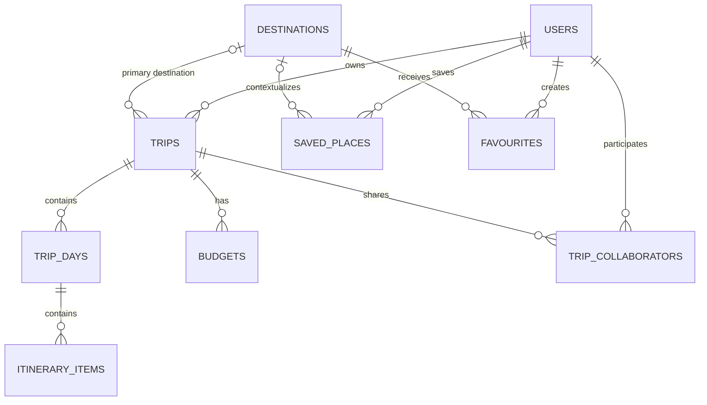

# Planned Database Design

This document describes a proposed relational model for AtlasAI's core travel-planning data. It is a design reference, not an implemented schema. PostgreSQL managed through Supabase is the planned persistence layer; table names, fields, constraints, and access policies will be finalized during implementation. No database migrations are defined here.

## Design Overview

The model separates reusable destination records from each traveler's plans and saved content. A trip is owned by one user and can be shared with other users through collaborator records. Each trip is divided into days, and each day contains ordered itinerary items. Budgets belong to trips, while saved places and destination favourites belong to users.

## Entities

### `users`

Represents an AtlasAI account and its application profile. Authentication credentials should be managed by the chosen authentication provider; this entity stores the application-facing user identity and profile information needed by the product.

**Relationships:** A user can own many trips, save many places, create many destination favourites, and participate in many trips through `trip_collaborators`.

### `destinations`

Represents a reusable destination in the discovery catalogue, such as a city or region. It can hold display and geographic metadata used by recommendations, trip planning, and saved content. It is distinct from a user's saved point of interest.

**Relationships:** A destination can be the primary destination for many trips, provide context for many saved places, and be favourited by many users through `favourites`.

### `trips`

Represents a travel plan, including its owner, name, travel date range, and planning status or preferences. The initial model allows an optional primary destination for a trip. If trips need to cover multiple destinations, a separate trip-to-destination join entity can be introduced rather than overloading this field.

**Relationships:** Each trip has one owning user and may have one primary destination. A trip can contain many `trip_days`, have multiple `budgets`, and be shared with many users through `trip_collaborators`.

### `trip_days`

Represents one planned day within a trip. It provides a date or day sequence so itinerary items can be grouped and presented in travel order.

**Relationships:** Each trip day belongs to one trip and can contain many `itinerary_items`. A trip day should be unique within its trip by date or sequence, according to the final date-handling rules.

### `itinerary_items`

Represents a scheduled activity, stop, meal, reservation, or other plan item on a trip day. It can contain ordering and timing information, a title, notes, and location details needed to render the itinerary.

**Relationships:** Each itinerary item belongs to one trip day. Through that day, it belongs to a trip. Location information may refer to a catalogue destination or an external place provider, but an itinerary item should remain usable as a planned entry even when no catalogue record exists.

### `saved_places`

Represents an individual place a user saves for later, such as a restaurant, attraction, or point of interest. Place-provider identifiers and location metadata can help reconcile it with external map data. An optional destination association provides geographic context.

**Relationships:** Each saved place belongs to one user and may be associated with one destination. A user can save many places, and a destination can contextualize saved places belonging to many users.

### `favourites`

Represents a user's explicit favourite of a catalogue destination. This is a user-to-destination relationship, rather than a duplicate place record. Keeping it separate from `saved_places` distinguishes favouriting a broad destination from saving a specific point of interest.

**Relationships:** Each favourite joins one user to one destination. The same user should have at most one favourite record for a given destination; both a user and a destination can be related to many favourites.

### `budgets`

Represents a planned spending amount for a trip. Records can describe the overall budget or a category allocation (for example, lodging or food), with an amount and currency. Category and total semantics should be made explicit in the implemented schema so totals are not accidentally double-counted.

**Relationships:** Each budget belongs to one trip. A trip can have multiple budget records, and its owner and collaborators access them through their trip relationship.

### `trip_collaborators`

Associates a user with a trip they do not own, enabling shared planning. The record can store a role or permission level and an invitation or membership status.

**Relationships:** Each collaborator record joins one user to one trip. A trip can have many collaborators, and a user can collaborate on many trips. A trip/user pair should be unique; the trip owner remains represented by `trips` ownership rather than requiring a duplicate collaborator row.

## Relationship Summary

- One user owns many trips; each trip has exactly one owner.
- A trip may have one primary destination in the initial model; destinations are reusable across trips.
- A trip has many days, and each day has many ordered itinerary items.
- Users save places independently of their destination favourites.
- A trip can have budget records for overall and category planning.
- `trip_collaborators` implements the many-to-many relationship between users and trips other than ownership.

## Implementation Considerations

- Use stable primary keys and enforce foreign-key and uniqueness constraints when the schema is implemented.
- Protect user-owned records and shared trip data with authorization rules consistent with trip ownership and collaborator permissions.
- Define deletion and archival behavior before adding cascading foreign keys, particularly for trips, itinerary history, and saved content.
- Treat provider-specific place data as external references and retain enough descriptive location data for a useful user experience if a provider record changes.
- Keep this document conceptual; migrations, database policies, and API contracts are separate implementation work.
