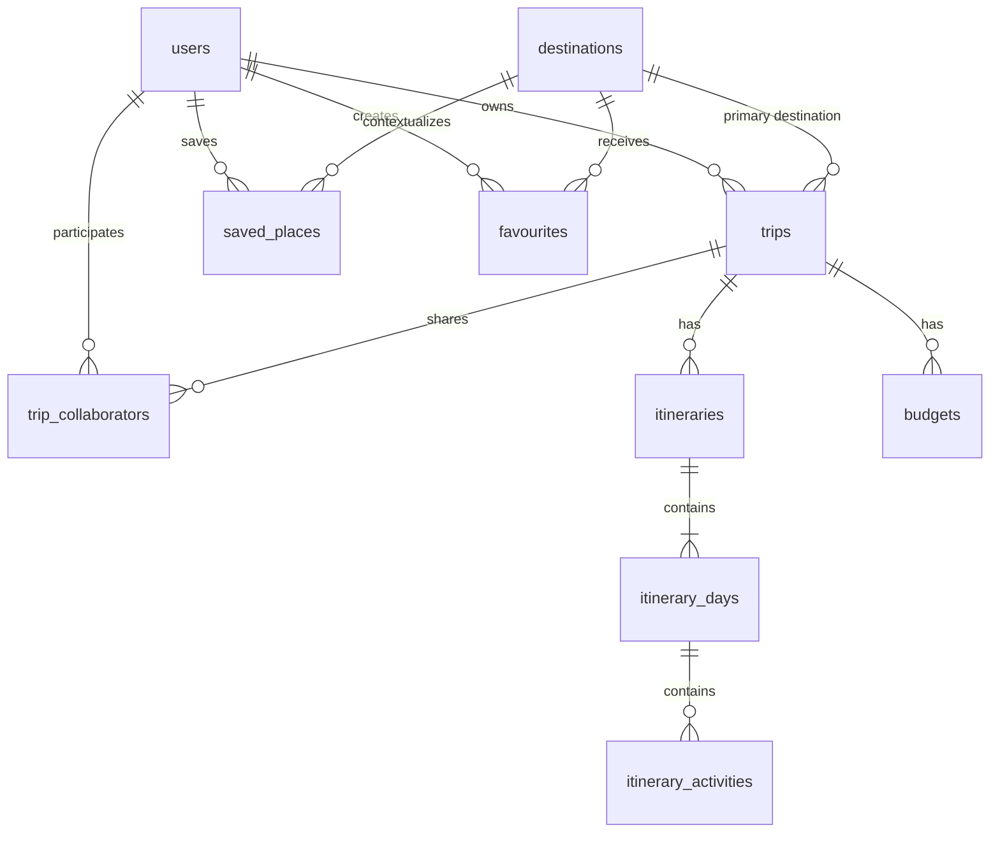

# Planned Database Design (MongoDB Atlas)

This document describes the proposed MongoDB data model for AtlasAI's core travel-planning data. It is a **design reference, not an implemented schema**. MongoDB Atlas is the planned cloud database, and Mongoose is the planned ODM (Object Data Modeling) library inside the Node.js Express API. Collection names, fields, validators, and indexes will be finalized when the implementation begins. **No connection code, models, or migrations exist yet** — see [Not implemented yet](#not-implemented-yet).

> If you are new to MongoDB: a "document" is a JSON-like object, similar to a row in a table but able to contain nested objects and arrays. Documents are grouped into "collections" (similar to tables). Each document automatically gets an `_id` field of type `ObjectId` — a unique 12-byte identifier — unless you define one yourself.

## Design Overview

The model separates reusable destination records from each traveler's plans and saved content. A trip is owned by one user and can be shared with other users through collaborator records. Each trip is divided into days, and each day contains ordered itinerary items. Budgets belong to trips, while saved places and destination favourites belong to users. Identity and permission data hangs off the user and trip.



All arrows represent **references** (an `ObjectId` stored in one document pointing to another document), except where
a sub-document is embedded — embedding rules are explained in [Embedding vs. Referencing](#embedding-vs-referencing).

## Design Principles Used

These are the rules the model follows, so you can see _why_ each collection exists.

1. **One collection per business concept that has its own lifecycle, permissions, or independent queries.** A trip's
   days and activities are queried with the trip, so they can live in their own collections but are always scoped by
   `trip_id`.
2. **Embed data that is always read together and never queried on its own** (for example, a day's time-zone or an
   activity's `location` object).
3. **Reference data that is shared, grows without bound, or is queried independently** (for example, destinations,
   users, saved places).
4. **Use `ObjectId` references (`type: mongoose.Schema.Types.ObjectId`) with Mongoose `ref`,** so the backend can
   `populate()` or join with `$lookup` when needed.
5. **Every document that is created by a user has `createdAt` and `updatedAt` timestamps** via Mongoose's
   `{ timestamps: true }` option.
6. **Validation lives in Mongoose schemas** (`required`, `enum`, `min`, `max`, `match`, `validate`, `maxlength`,
   `unique`). MongoDB itself only enforces some of this at the server level (unique indexes, `$jsonSchema`
   validators), so the API is the enforcement point.
7. **No client-side database access.** Only the Express API holds database credentials.

## Recommended Mongoose Conventions

Common conventions to apply to every model, so the API layer behaves consistently:

| Concern              | Convention                                                                                                                                                                          |
| -------------------- | ----------------------------------------------------------------------------------------------------------------------------------------------------------------------------------- |
| Collection name      | Explicitly set to the snake_case plural name in the schema (`collection: 'itinerary_days'`) so it never depends on Mongoose's auto-naming.                                          |
| Primary key          | MongoDB `_id` (`ObjectId`). The API exposes it to clients as `id` in JSON, never as `_id`.                                                                                          |
| Timestamps           | `{ timestamps: true }` on `users`, `destinations`, `trips`, `itineraries`, `itinerary_days`, `itinerary_activities`, `saved_places`, `favourites`, `budgets`, `trip_collaborators`. |
| Version key          | Keep the default `__v`; trip & itinerary documents may opt into Mongoose optimistic concurrency (`optimisticConcurrency: true`) to protect against concurrent collaborator edits.   |
| Soft delete          | `deletedAt: Date \| null` (`null` = active) on user-owned content, instead of hard deletes. Every query filters `deletedAt: null`.                                                  |
| Enum values          | Stored in lowercase snake_case, validated by Mongoose `enum`.                                                                                                                       |
| Money                | Stored as **integer minor units** (e.g. cents/paise) plus a 3-letter ISO 4217 `currency`. Never `Float`/`Double` for money.                                                         |
| Dates vs. timestamps | Calendar days use `YYYY-MM-DD` strings (`date_key`); real instants use `Date` (UTC). This avoids off-by-one-day bugs from time zones.                                               |
| Local clock times    | A `HH:mm` string plus the day's `timezone`, so "10:00 in Kyoto" stays meaningful.                                                                                                   |
| Geo coordinates      | `location` is a GeoJSON `Point` (`{ type: 'Point', coordinates: [lng, lat] }`) with a `2dsphere` index. Note: longitude comes first.                                                |
| Text search          | A `search` field (or Atlas Search index) rather than regex scans.                                                                                                                   |

## Collections

### 1. `users`

An AtlasAI account and its application profile. Password credentials are **hashed** (`password_hash`, excluded from
queries by default with `select: false`). If authentication is later delegated to a provider, keep `auth_provider` and
`external_id` instead of a password hash.

**Relationships:** A user owns many trips, saves many places, creates many destination favourites, and participates in
many trips through `trip_collaborators`.

```javascript
// Illustrative Mongoose schema (not implemented)
const userSchema = new mongoose.Schema(
  {
    email: {
      type: String,
      required: true,
      lowercase: true,
      trim: true,
      match: /^[^@\s]+@[^@\s]+\.[^@\s]+$/,
      maxlength: 254,
    },
    password_hash: { type: String, required: true, select: false },
    auth_provider: {
      type: String,
      enum: ["local", "google", "apple"],
      default: "local",
    },
    external_id: { type: String, default: null }, // provider subject id, if any

    display_name: {
      type: String,
      required: true,
      trim: true,
      minlength: 1,
      maxlength: 80,
    },
    avatar_url: { type: String, trim: true, maxlength: 2048, default: null },
    home_city: { type: String, trim: true, maxlength: 120, default: null },
    home_country_code: {
      type: String,
      uppercase: true,
      match: /^[A-Z]{2}$/,
      default: null,
    },
    preferred_currency: {
      type: String,
      uppercase: true,
      match: /^[A-Z]{3}$/,
      default: "USD",
    },
    preferred_language: { type: String, default: "en", maxlength: 10 },

    // Preferences specific to this product, embedded (always read with the user)
    travel_preferences: {
      pace: {
        type: String,
        enum: ["relaxed", "balanced", "packed"],
        default: "balanced",
      },
      interests: {
        type: [String],
        default: [],
        validate: (v) => v.length <= 20,
      },
      dietary_restrictions: { type: [String], default: [] },
      accessibility_needs: { type: [String], default: [] },
    },

    role: { type: String, enum: ["traveler", "admin"], default: "traveler" },
    status: {
      type: String,
      enum: ["active", "suspended", "deleted"],
      default: "active",
    },
    last_login_at: { type: Date, default: null },
    deletedAt: { type: Date, default: null },
  },
  { timestamps: true, collection: "users" },
);
```

| Field                        | Type                   | Rules                                 |
| ---------------------------- | ---------------------- | ------------------------------------- |
| `_id`                        | `ObjectId`             | Auto-generated                        |
| `email`                      | String                 | required, unique, lowercased, max 254 |
| `password_hash`              | String, `select:false` | required for `auth_provider: 'local'` |
| `display_name`               | String                 | required, 1–80 chars                  |
| `travel_preferences`         | embedded object        | bounded arrays (max 20 interests)     |
| `role` / `status`            | String enum            | controlled vocabulary                 |
| `last_login_at`, `deletedAt` | Date \| null           | —                                     |
| `createdAt` / `updatedAt`    | Date                   | automatic                             |

### 2. `destinations`

A reusable destination in the discovery catalogue, such as a city or region. This is a **shared, admin/maintained
dataset**, so it is its own collection and referenced by trips, saved places, and favourites.

**Relationships:** A destination can be the primary destination for many trips, provide context for many saved places,
and be favourited by many users.

```javascript
const destinationSchema = new mongoose.Schema(
  {
    name: { type: String, required: true, trim: true, maxlength: 120 },
    slug: {
      type: String,
      required: true,
      lowercase: true,
      match: /^[a-z0-9-]+$/,
    },
    country: { type: String, required: true, trim: true, maxlength: 120 },
    country_code: {
      type: String,
      required: true,
      uppercase: true,
      match: /^[A-Z]{2}$/,
    },
    region: { type: String, trim: true, maxlength: 120, default: null },
    description: { type: String, maxlength: 5000, default: "" },

    location: {
      // GeoJSON Point
      type: { type: String, enum: ["Point"], default: "Point" },
      coordinates: {
        type: [Number],
        required: true,
        validate: (v) => v.length === 2,
      }, // [lng, lat]
    },
    timezone: { type: String, required: true }, // IANA name, e.g. "Asia/Tokyo"

    tags: { type: [String], default: [], validate: (v) => v.length <= 30 },
    best_time_to_visit: { type: [String], default: [] },
    avg_daily_budget: {
      amount: { type: Number, min: 0, default: null }, // minor units
      currency: {
        type: String,
        uppercase: true,
        match: /^[A-Z]{3}$/,
        default: "USD",
      },
    },
    popularity_score: { type: Number, min: 0, max: 100, default: 0 },
    hero_image_url: {
      type: String,
      trim: true,
      maxlength: 2048,
      default: null,
    },
    source: {
      type: String,
      enum: ["admin", "openstreetmap", "provider"],
      default: "admin",
    },
    external_ref: { type: String, default: null }, // e.g. an OpenStreetMap id
    is_published: { type: Boolean, default: true },
  },
  { timestamps: true, collection: "destinations" },
);
```

`_id`, `createdAt`, `updatedAt`: automatic. `avg_daily_budget` and `best_time_to_visit` are embedded because they are
display metadata read together with the destination and never queried alone.

### 3. `trips`

A travel plan: owner, name, date range, status, and planning preferences. The trip is the **permission boundary** —
almost every other record points back to a trip or a user so access can be checked in one place.

**Relationships:** each trip has exactly one owning user (`owner_id`) and an optional primary `destination_id`. A trip
has many `itineraries`, many `budgets`, and many `trip_collaborators`.

```javascript
const tripSchema = new mongoose.Schema(
  {
    owner_id: {
      type: mongoose.Schema.Types.ObjectId,
      ref: "User",
      required: true,
    },
    name: {
      type: String,
      required: true,
      trim: true,
      minlength: 1,
      maxlength: 120,
    },
    description: { type: String, maxlength: 2000, default: "" },
    destination_id: {
      type: mongoose.Schema.Types.ObjectId,
      ref: "Destination",
      default: null,
    },
    additional_destination_ids: {
      type: [{ type: mongoose.Schema.Types.ObjectId, ref: "Destination" }],
      default: [],
      validate: (v) => v.length <= 10,
    },

    start_date: { type: String, required: true, match: /^\d{4}-\d{2}-\d{2}$/ }, // date_key
    end_date: { type: String, required: true, match: /^\d{4}-\d{2}-\d{2}$/ },
    date_range: { type: [Date], default: undefined }, // optional, for date-range queries

    status: {
      type: String,
      enum: ["draft", "planning", "booked", "completed", "cancelled"],
      default: "planning",
    },
    visibility: {
      type: String,
      enum: ["private", "unlisted"],
      default: "private",
    },
    cover_image_url: {
      type: String,
      trim: true,
      maxlength: 2048,
      default: null,
    },
    traveller_count: { type: Number, min: 1, max: 50, default: 1 },
    tags: { type: [String], default: [], validate: (v) => v.length <= 20 },

    // Snapshot of the trip's planning preferences (bounded, always read with the trip)
    preferences: {
      pace: {
        type: String,
        enum: ["relaxed", "balanced", "packed"],
        default: "balanced",
      },
      interests: {
        type: [String],
        default: [],
        validate: (v) => v.length <= 20,
      },
      notes: { type: String, maxlength: 2000, default: "" },
    },

    // Usage counters for listing/dashboard without extra queries
    stats: {
      day_count: { type: Number, min: 0, default: 0 },
      activity_count: { type: Number, min: 0, default: 0 },
      budget_total_minor: { type: Number, min: 0, default: 0 },
      currency: {
        type: String,
        uppercase: true,
        match: /^[A-Z]{3}$/,
        default: "USD",
      },
    },

    archived_at: { type: Date, default: null },
    deletedAt: { type: Date, default: null },
  },
  { timestamps: true, collection: "trips", optimisticConcurrency: true },
);
```

Business validation in the API: `end_date >= start_date`, and `date_range` must match when both it and the date keys
are set.

### 4. `itineraries`

An itinerary is a **named plan version** for a trip, for example "Original plan", "Rainy-day plan", or a draft produced
by the AI service. It sits between the trip and its days so a trip can hold several plans and so the AI service can
propose alternatives that are saved as drafts without touching the live plan.

**Relationships:** each itinerary belongs to one trip (`trip_id`) and contains many `itinerary_days`. `is_primary`
marks the plan the UI shows by default; only one itinerary per trip should have it (enforced in the API, and optionally
by a partial unique index).

```javascript
const itinerarySchema = new mongoose.Schema(
  {
    trip_id: {
      type: mongoose.Schema.Types.ObjectId,
      ref: "Trip",
      required: true,
    },
    created_by: {
      type: mongoose.Schema.Types.ObjectId,
      ref: "User",
      required: true,
    },
    name: {
      type: String,
      required: true,
      trim: true,
      minlength: 1,
      maxlength: 120,
    },
    description: { type: String, maxlength: 2000, default: "" },
    version: { type: Number, min: 1, default: 1 },
    is_primary: { type: Boolean, default: false },
    status: {
      type: String,
      enum: ["draft", "active", "archived"],
      default: "draft",
    },
    source: {
      type: String,
      enum: ["user", "ai", "template", "imported"],
      default: "user",
    },
    ai_metadata: {
      // embedded: small, only meaningful for AI drafts
      model: { type: String, default: null },
      prompt_version: { type: String, default: null },
      generated_at: { type: Date, default: null },
    },
    stats: {
      day_count: { type: Number, min: 0, default: 0 },
      activity_count: { type: Number, min: 0, default: 0 },
      estimated_cost_minor: { type: Number, min: 0, default: 0 },
      currency: {
        type: String,
        uppercase: true,
        match: /^[A-Z]{3}$/,
        default: "USD",
      },
    },
    archived_at: { type: Date, default: null },
    deletedAt: { type: Date, default: null },
  },
  { timestamps: true, collection: "itineraries", optimisticConcurrency: true },
);
```

### 5. `itinerary_days`

One planned day inside an itinerary. It carries the sequence (travel order), the calendar date, and the time zone so
activity clock times are unambiguous.

**Relationships:** belongs to one itinerary (`itinerary_id`) and one trip (`trip_id`, denormalized so trip-wide
queries — and permission checks — don't need to hop through the itinerary). Contains many `itinerary_activities`.

```javascript
const itineraryDaySchema = new mongoose.Schema(
  {
    itinerary_id: {
      type: mongoose.Schema.Types.ObjectId,
      ref: "Itinerary",
      required: true,
    },
    trip_id: {
      type: mongoose.Schema.Types.ObjectId,
      ref: "Trip",
      required: true,
    }, // denormalized
    day_index: { type: Number, required: true, min: 1 }, // 1-based order within the itinerary
    date_key: { type: String, required: true, match: /^\d{4}-\d{2}-\d{2}$/ },
    timezone: { type: String, required: true }, // IANA, copied from the destination
    title: { type: String, trim: true, maxlength: 160, default: "" },
    notes: { type: String, maxlength: 2000, default: "" },
    base_location: {
      // optional "home base" for the day
      name: { type: String, trim: true, maxlength: 200 },
      coordinates: { type: [Number], default: undefined }, // [lng, lat]
    },
    stats: {
      activity_count: { type: Number, min: 0, default: 0 },
      planned_cost_minor: { type: Number, min: 0, default: 0 },
      currency: {
        type: String,
        uppercase: true,
        match: /^[A-Z]{3}$/,
        default: "USD",
      },
    },
  },
  { timestamps: true, collection: "itinerary_days" },
);
```

Uniqueness: one day per `(itinerary_id, day_index)` and per `(itinerary_id, date_key)`.

### 6. `itinerary_activities`

A scheduled activity, stop, meal, reservation, or other plan item on a day. It has its own collection (rather than
being embedded in the day) because activities are the most frequently and independently mutated records — users
add, move, reorder, and delete single items — and because per-activity data (external place ids, costs, bookings) can
grow.

**Relationships:** belongs to one day (`day_id`), one itinerary (`itinerary_id`), and one trip (`trip_id`), all
denormalized. May reference a catalogue `destination_id` or a saved place `saved_place_id`, but never derives its
display name from them — a planned entry must still render if the catalogue record changes.

```javascript
const itineraryActivitySchema = new mongoose.Schema(
  {
    day_id: {
      type: mongoose.Schema.Types.ObjectId,
      ref: "ItineraryDay",
      required: true,
    },
    itinerary_id: {
      type: mongoose.Schema.Types.ObjectId,
      ref: "Itinerary",
      required: true,
    },
    trip_id: {
      type: mongoose.Schema.Types.ObjectId,
      ref: "Trip",
      required: true,
    },

    position: { type: Number, required: true, min: 0 }, // ordering within the day
    title: {
      type: String,
      required: true,
      trim: true,
      minlength: 1,
      maxlength: 160,
    },
    category: {
      type: String,
      enum: [
        "sightseeing",
        "food",
        "transport",
        "lodging",
        "shopping",
        "activity",
        "rest",
        "other",
      ],
      default: "other",
    },
    notes: { type: String, maxlength: 2000, default: "" },

    start_time: {
      type: String,
      match: /^([01]\d|2[0-3]):[0-5]\d$/,
      default: null,
    }, // HH:mm local
    end_time: {
      type: String,
      match: /^([01]\d|2[0-3]):[0-5]\d$/,
      default: null,
    },
    duration_minutes: { type: Number, min: 0, max: 24 * 60, default: null },
    // Derived on save from date_key + start_time + day timezone, so dates sort/filter natively
    starts_at: { type: Date, default: null },

    location: {
      // embedded snapshot of the place
      name: { type: String, trim: true, maxlength: 200, default: null },
      address: { type: String, trim: true, maxlength: 500, default: null },
      point: {
        type: { type: String, enum: ["Point"], default: "Point" }, // GeoJSON
        coordinates: { type: [Number], default: undefined },
      },
      provider: {
        type: String,
        enum: ["manual", "openstreetmap", "google", "other"],
        default: "manual",
      },
      provider_place_id: { type: String, default: null },
    },
    destination_id: {
      type: mongoose.Schema.Types.ObjectId,
      ref: "Destination",
      default: null,
    },
    saved_place_id: {
      type: mongoose.Schema.Types.ObjectId,
      ref: "SavedPlace",
      default: null,
    },

    cost: {
      amount_minor: { type: Number, min: 0, default: 0 },
      currency: {
        type: String,
        uppercase: true,
        match: /^[A-Z]{3}$/,
        default: "USD",
      },
      status: {
        type: String,
        enum: ["estimated", "booked", "paid"],
        default: "estimated",
      },
    },
    booking: {
      // embedded, small and 1:1
      reference: { type: String, trim: true, maxlength: 120, default: null },
      provider: { type: String, trim: true, maxlength: 120, default: null },
      confirmed: { type: Boolean, default: false },
    },
    attachments: {
      type: [
        { name: String, url: String, mime_type: String, size_bytes: Number },
      ],
      default: [],
      validate: (v) => v.length <= 10,
    },

    status: {
      type: String,
      enum: ["planned", "done", "skipped"],
      default: "planned",
    },
    added_by: {
      type: mongoose.Schema.Types.ObjectId,
      ref: "User",
      default: null,
    },
    source: { type: String, enum: ["user", "ai", "imported"], default: "user" },
    deletedAt: { type: Date, default: null },
  },
  { timestamps: true, collection: "itinerary_activities" },
);
```

### 7. `saved_places`

A specific point of interest a user saves for later (restaurant, museum, viewpoint). It is **user-owned**, has its own
lifecycle, and is reused across trips, so it is a separate collection — not embedded in the user document, where the
array would grow unbounded.

**Relationships:** belongs to one user (`user_id`) and may reference one `destination_id`. It can be referenced by many
`itinerary_activities` across trips.

```javascript
const savedPlaceSchema = new mongoose.Schema(
  {
    user_id: {
      type: mongoose.Schema.Types.ObjectId,
      ref: "User",
      required: true,
    },
    destination_id: {
      type: mongoose.Schema.Types.ObjectId,
      ref: "Destination",
      default: null,
    },

    name: { type: String, required: true, trim: true, maxlength: 200 },
    category: {
      type: String,
      enum: [
        "restaurant",
        "cafe",
        "attraction",
        "museum",
        "park",
        "shopping",
        "lodging",
        "transport",
        "other",
      ],
      default: "other",
    },
    notes: { type: String, maxlength: 2000, default: "" },
    tags: { type: [String], default: [], validate: (v) => v.length <= 20 },

    location: {
      type: { type: String, enum: ["Point"], default: "Point" },
      coordinates: {
        type: [Number],
        required: true,
        validate: (v) => v.length === 2,
      }, // [lng, lat]
    },
    address: { type: String, trim: true, maxlength: 500, default: null },

    provider: {
      type: String,
      enum: ["manual", "openstreetmap", "google", "other"],
      default: "manual",
    },
    provider_place_id: { type: String, default: null },
    rating: { type: Number, min: 0, max: 5, default: null },
    price_level: { type: Number, min: 1, max: 4, default: null },
    image_url: { type: String, trim: true, maxlength: 2048, default: null },
    deletedAt: { type: Date, default: null },
  },
  { timestamps: true, collection: "saved_places" },
);
```

### 8. `favourites`

A user's explicit favourite of a **catalogue destination**. Keeping this a small join-style collection (rather than an
array on the user or on the destination) makes "who favourited this?" and "what did I favourite?" both cheap, and
prevents duplicate entries with a unique compound index. This is deliberately different from `saved_places`
(favourite a _destination_, save a _point of interest_).

**Relationships:** each favourite joins one user to one destination.

```javascript
const favouriteSchema = new mongoose.Schema(
  {
    user_id: {
      type: mongoose.Schema.Types.ObjectId,
      ref: "User",
      required: true,
    },
    destination_id: {
      type: mongoose.Schema.Types.ObjectId,
      ref: "Destination",
      required: true,
    },
    note: { type: String, maxlength: 500, default: "" },
  },
  { timestamps: true, collection: "favourites" }, // createdAt is the "favourited at" time
);
// unique index: { user_id: 1, destination_id: 1 }
```

### 9. `budgets`

A planned spending amount for a trip. Records can describe the overall budget (`category: 'total'`) or a category
allocation (`lodging`, `food`, `transport`, …). Because budgets are edited independently, reported on separately, and
may later include actual spend, they are their own collection. **Totals must not be double counted:** the `'total'`
record is the cap, while category records are allocations; category sums are never added to `'total'`.

**Relationships:** belongs to one trip (`trip_id`) and records who last changed it (`updated_by`). Owner and
collaborators reach it through their trip permission.

```javascript
const budgetSchema = new mongoose.Schema(
  {
    trip_id: {
      type: mongoose.Schema.Types.ObjectId,
      ref: "Trip",
      required: true,
    },
    category: {
      type: String,
      enum: [
        "total",
        "lodging",
        "food",
        "transport",
        "activities",
        "shopping",
        "miscellaneous",
      ],
      required: true,
    },
    planned_amount_minor: { type: Number, required: true, min: 0 }, // integer minor units
    actual_amount_minor: { type: Number, min: 0, default: 0 }, // integer minor units
    currency: {
      type: String,
      required: true,
      uppercase: true,
      match: /^[A-Z]{3}$/,
    },
    notes: { type: String, maxlength: 1000, default: "" },
    updated_by: {
      type: mongoose.Schema.Types.ObjectId,
      ref: "User",
      default: null,
    },
    deletedAt: { type: Date, default: null },
  },
  { timestamps: true, collection: "budgets" },
);
// unique index (active docs only): { trip_id: 1, category: 1 }
```

### 10. `trip_collaborators`

Associates a user with a trip they do not own. Holds the role/permission level and the invitation lifecycle. This is
the **authorization lookup table** for shared trips.

**Relationships:** joins one user to one trip. The owner is represented by `trips.owner_id` and must **not** also have
a collaborator row for the same trip. A `(trip_id, user_id)` pair is unique.

```javascript
const tripCollaboratorSchema = new mongoose.Schema(
  {
    trip_id: {
      type: mongoose.Schema.Types.ObjectId,
      ref: "Trip",
      required: true,
    },
    user_id: {
      type: mongoose.Schema.Types.ObjectId,
      ref: "User",
      required: true,
    },
    invited_by: {
      type: mongoose.Schema.Types.ObjectId,
      ref: "User",
      required: true,
    },
    invited_email: { type: String, lowercase: true, trim: true, default: null },

    role: {
      type: String,
      enum: ["viewer", "editor", "admin"],
      default: "viewer",
    },
    status: {
      type: String,
      enum: ["invited", "active", "declined", "revoked"],
      default: "invited",
    },
    invited_at: { type: Date, default: Date.now },
    accepted_at: { type: Date, default: null },
    revoked_at: { type: Date, default: null },
    expires_at: { type: Date, default: null }, // invite expiry
  },
  { timestamps: true, collection: "trip_collaborators" },
);
// unique index: { trip_id: 1, user_id: 1 }
```

## Embedding vs. Referencing

This is the most important MongoDB design decision. A simple rule: **embed what is tiny, bounded, and always read
with its parent; reference anything shared, unbounded, independently queried, or independently permissioned.**

| Data                                                              | Decision                                   | Why                                                                                                                                             |
| ----------------------------------------------------------------- | ------------------------------------------ | ----------------------------------------------------------------------------------------------------------------------------------------------- |
| `users.travel_preferences`, `users.role/status`                   | **Embed**                                  | Small, fixed shape, always loaded with the user.                                                                                                |
| `destinations.avg_daily_budget`, `best_time_to_visit`, `location` | **Embed**                                  | Display metadata read together; no independent queries.                                                                                         |
| `trips.preferences`, `trips.stats`, `trips.date_range`            | **Embed**                                  | Bounded objects; avoid extra queries for list/dashboard views.                                                                                  |
| `trips` → `itineraries`                                           | **Reference** (`trip_id`)                  | Multiple plans per trip; independently named/versioned/archived.                                                                                |
| `itineraries` → `itinerary_days`                                  | **Reference** (`itinerary_id`)             | Days have their own timestamps and are patched/reordered individually.                                                                          |
| `itinerary_days` → `itinerary_activities`                         | **Reference** (`day_id`)                   | Activities are mutated constantly and individually; a growing array would quickly hit document size and rewrite costs.                          |
| `itinerary_activities.location`, `.cost`, `.booking`              | **Embed**                                  | 1:1 sub-objects, small, always displayed with the activity. **Snapshot** of place data, not a live reference.                                   |
| `itinerary_activities.attachments`                                | **Embed** (capped at 10)                   | Small list; binary files themselves live in object storage, only URLs are stored.                                                               |
| `trips` → `destinations`                                          | **Reference** (`destination_id`)           | Shared catalogue data; many trips point to one destination.                                                                                     |
| `trips` → `budgets`                                               | **Reference** (`trip_id`)                  | Budgets are edited/reported separately and may grow with actuals.                                                                               |
| `trips`/`users` → `trip_collaborators`                            | **Reference** (join collection)            | Many-to-many with per-row metadata (role, status); needs unique enforcement.                                                                    |
| `users` → `saved_places`                                          | **Reference** (`user_id`)                  | Unbounded over time; paginated and searched independently.                                                                                      |
| `users` + `destinations` in `favourites`                          | **Reference** (join collection)            | Many-to-many; unique pair; small and cheap to dedupe.                                                                                           |
| `itinerary_activities` → `destinations` / `saved_places`          | **Optional reference** + embedded snapshot | The reference enables navigation; the snapshot keeps the plan readable if the source changes or is deleted (e.g. a user deletes a saved place). |

**Why not one big `trips` document containing days, activities, budgets and collaborators?**
It is tempting, and for a small personal app it can work. But here: (a) collaborators and budgets need their own
unique constraints and permission checks; (b) activities are edited one-by-one, and every edit would rewrite the whole
trip; (c) a long trip could approach MongoDB's 16 MB document limit; (d) collaborator queries ("all trips I can see")
would need to scan every trip document. Separate collections with denormalized `trip_id` give cheap, indexed trip-scoped
reads with a bounded document size.

**Denormalization note:** `trip_id` is stored on `itinerary_days` and `itinerary_activities` (and `itinerary_id` on
activities) on purpose. Denormalized fields in MongoDB are safe when they never change (a day never moves to another
trip) and they turn multi-hop permission checks into one indexed lookup. `migrate`/repair jobs should still be able to
recompute them.

## Index Recommendations

Indexes should support the actual query patterns of the API. `_id` is indexed automatically; the rest are created in
Mongoose schema definitions (`schema.index(...)`) when models are implemented.

| Collection             | Index                                                                                                | Query pattern it serves                                                 |
| ---------------------- | ---------------------------------------------------------------------------------------------------- | ----------------------------------------------------------------------- |
| `users`                | `{ email: 1 }` unique                                                                                | Login, signup uniqueness, profile lookup.                               |
| `users`                | `{ external_id: 1 }` unique **partial** (`auth_provider != 'local'`)                                 | OAuth/provider login.                                                   |
| `destinations`         | `{ slug: 1 }` unique                                                                                 | Destination page by slug.                                               |
| `destinations`         | `{ country_code: 1, popularity_score: -1 }`                                                          | Browse/filter the catalogue by country, ranked.                         |
| `destinations`         | `{ location: '2dsphere' }`                                                                           | Nearby / "destinations around me" queries.                              |
| `destinations`         | Atlas Search index on `name`, `country`, `region`, `tags` (or `{ name: 'text', tags: 'text' }`)      | Search-as-you-type destination search.                                  |
| `trips`                | `{ owner_id: 1, updatedAt: -1 }`                                                                     | "My trips", most recently edited first.                                 |
| `trips`                | `{ owner_id: 1, deletedAt: 1, status: 1 }`                                                           | Filtered trip lists, excluding soft-deleted.                            |
| `trips`                | `{ destination_id: 1 }`                                                                              | Trips for a destination; destination popularity.                        |
| `trips`                | `{ start_date: 1, end_date: 1 }`                                                                     | Date-range/"upcoming trips" queries.                                    |
| `itineraries`          | `{ trip_id: 1, is_primary: -1, updatedAt: -1 }`                                                      | Load the trip's default itinerary + list plans.                         |
| `itineraries`          | `{ trip_id: 1, is_primary: 1 }` unique **partial** where `is_primary: true`                          | At most one primary itinerary per trip.                                 |
| `itinerary_days`       | `{ itinerary_id: 1, day_index: 1 }` unique                                                           | Day list in travel order; prevents duplicate day numbers.               |
| `itinerary_days`       | `{ itinerary_id: 1, date_key: 1 }` unique                                                            | Day by calendar date; prevents two days on one date.                    |
| `itinerary_days`       | `{ trip_id: 1, date_key: 1 }`                                                                        | Whole-trip calendar / cross-itinerary lookups, permission-scoped reads. |
| `itinerary_activities` | `{ day_id: 1, position: 1 }`                                                                         | Render a day's activities in order.                                     |
| `itinerary_activities` | `{ trip_id: 1, starts_at: 1 }`                                                                       | Trip timeline, "next activity", date-range checks.                      |
| `itinerary_activities` | `{ trip_id: 1, saved_place_id: 1 }` partial (`saved_place_id != null`)                               | "Which of my plans include this saved place?"                           |
| `itinerary_activities` | `{ location.point: '2dsphere' }` partial (`location.point exists`)                                   | Map view of a trip's activities.                                        |
| `saved_places`         | `{ user_id: 1, updatedAt: -1 }`                                                                      | A user's saved places list.                                             |
| `saved_places`         | `{ user_id: 1, destination_id: 1 }`                                                                  | Saved places for a destination.                                         |
| `saved_places`         | `{ user_id: 1, provider: 1, provider_place_id: 1 }` unique **partial** (`provider_place_id != null`) | Prevent saving the same external place twice.                           |
| `saved_places`         | `{ location: '2dsphere' }`                                                                           | "Save places near me".                                                  |
| `favourites`           | `{ user_id: 1, destination_id: 1 }` unique                                                           | Enforces one favourite per user/destination; dedupes toggle.            |
| `favourites`           | `{ destination_id: 1, createdAt: -1 }`                                                               | Favourite count / recent fans of a destination.                         |
| `budgets`              | `{ trip_id: 1, category: 1 }` unique **partial** where `deletedAt: null`                             | One active budget per category per trip.                                |
| `trip_collaborators`   | `{ trip_id: 1, user_id: 1 }` unique                                                                  | Permission lookup; prevents duplicate invites.                          |
| `trip_collaborators`   | `{ user_id: 1, status: 1, updatedAt: -1 }`                                                           | "Trips shared with me".                                                 |
| `trip_collaborators`   | `{ invited_email: 1, status: 1 }` partial (`status: 'invited'`)                                      | Accepted invites matching a new user's email.                           |

Workload cost note: every index speeds reads but slows writes and consumes memory. Do not index fields that are only
ever returned, not filtered; start with the list above and let Atlas's Performance Advisor flag unused indexes later.

## Ownership and Trip Permissions

MongoDB Atlas does **not** provide per-user row-level security for application queries the way a relational database
with RLS policies would. **Authorization therefore belongs in the Express API layer**, in one reusable place, not
scattered through controllers.

**1. Two user-owned scopes**

- _Personal scope_: `users` → `saved_places`, `favourites` (and `users` themselves). Rule: `document.user_id` must
  equal `req.user.id`. The API must always inject `user_id` from the authenticated token — never read it from the
  request body — so a user cannot create data for someone else.
- _Trip scope_: `trips` and everything beneath them (`itineraries`, `itinerary_days`, `itinerary_activities`,
  `budgets`, `trip_collaborators`). Rule: access requires being the owner or an active collaborator.

**2. Effective role resolution**

```
resolveTripRole(tripId, userId):
  trip = Trip.findById(tripId)
  if not trip or trip.deletedAt:                 -> NOT_FOUND
  if trip.owner_id == userId:                    -> OWNER
  c = TripCollaborator.findOne({ trip_id: tripId, user_id: userId, status: 'active' })
  return c ? c.role : NONE
```

**3. Role capability matrix**

| Action                                          | viewer | editor | admin (collaborator) | owner |
| ----------------------------------------------- | ------ | ------ | -------------------- | ----- |
| Read trip, itinerary, days, activities, budgets | ✅     | ✅     | ✅                   | ✅    |
| Add/edit/delete days & activities               | ❌     | ✅     | ✅                   | ✅    |
| Edit budget records                             | ❌     | ✅     | ✅                   | ✅    |
| Rename trip, edit dates, set visibility         | ❌     | ❌     | ✅                   | ✅    |
| Add/remove collaborators, change roles          | ❌     | ❌     | ❌                   | ✅    |
| Transfer ownership / delete trip                | ❌     | ❌     | ❌                   | ✅    |

Roles are ordered (`viewer < editor < admin < owner`); guard middleware checks a **minimum role**, so a single
`requireTripRole('editor')` covers both editors and admins.

**4. Implementation pattern in the API**

1. Authenticate the request (verify JWT) → `req.user.id`.
2. Load the trip scope once (from `trip_id` in the URL) and resolve the role → attach `req.tripRole`.
3. Authorize the route with `requireTripRole(...)`.
4. **Query with the scope in the filter**, so a leaked id can never cross scopes:
   `ItineraryActivity.updateOne({ _id: activityId, trip_id: req.trip.id, deletedAt: null }, …)`.
5. Validate that nested objects belong together: when creating a day, confirm the `itinerary_id` belongs to the
   `trip_id`; when creating an activity, derive `trip_id`/`itinerary_id` from the day — never from the request body.
6. Because the AI service may generate draft content, AI-created documents record `source: 'ai'` and `created_by` /
   `added_by`, and are still written through the API under the _requesting user's_ permissions.

**5. Database-level defence in depth**

- Atlas database users: the API uses a dedicated least-privilege user scoped to the application database; admin
  tooling uses a separate credential. The AI service has **no** Atlas credentials at all.
- Never expose `_id`s in an unauthenticated context; treat them as enumerable, not secret.
- Turn on Atlas's built-in **field-level encryption** or application-level encryption later if booking references or
  personal data become sensitive.
- Audit trail: `createdAt`/`updatedAt` plus `added_by`/`updated_by` support "who changed what" in shared trips.

**6. Invitation lifecycle**

`invited` → (user accepts) → `active` → (owner removes) → `revoked`. Declining sets `declined`; expired invites
(`expires_at` in the past) are treated as `revoked` by the resolver. Only `active` rows grant access.

**7. Deletion and cascade policy**

MongoDB has no foreign keys and no cascades, so these are explicit API operations:

- Deleting a **trip**: set `trips.deletedAt`, and soft-delete its itineraries, days, activities and budgets
  (recommended), or hard-delete them in the same request if the user confirms permanent deletion.
- Deleting a **saved place**: soft-delete it; activities keep their embedded `location` snapshot and lose only the
  optional `saved_place_id` link (or keep it as a dangling reference and resolve lazily).
- Deleting a **user**: set `status: 'deleted'`, anonymize profile fields, and remove `trip_collaborators` rows.
- Refuse to remove the owner via `trip_collaborators`; ownership transfer must be an explicit owner-only action.

## How the Backend Connects to MongoDB Atlas

Design only — **no connection code is part of this change**.

1. **Create the cluster in MongoDB Atlas** (your existing MongoDB account): a project, a free/shared or dedicated
   cluster, and a database name such as `atlasai`. Create a **database user** for the app (do not use your Atlas login)
   and add network access rules (your IP for local development, the hosting provider's egress IPs for production —
   avoid `0.0.0.0/0` in production).
2. **Get the connection string** from Atlas → _Connect → Drivers_. It looks like
   `mongodb+srv://<db_user>:<password>@<cluster-host>/atlasai?retryWrites=true&w=majority`. Treat it as a secret.
3. **Store it in an environment variable named `MONGODB_URI`** — never in source code, and never in a committed
   `.env` file (see `services/api/.env.example`, which only has a placeholder).
   - Local development: `services/api/.env` (git-ignored) or your shell environment.
   - Deployments: the host's secret manager / CI secret store.
4. **Read it only in the Node.js API**, e.g. `process.env.MONGODB_URI`, fail fast on startup if it is missing, and log
   a redacted form of the URI at most.
5. **Connect once with Mongoose** using a single shared connection created at startup (`mongoose.connect(...)`), with
   options such as `serverSelectionTimeoutMS`, `maxPoolSize` and `autoIndex: false` in production (build indexes
   deliberately). Models are registered on that connection; there is no per-request connection.
6. **Keep the URI out of error messages, logs and API responses.** If a connection error is surfaced to operators, log
   the reason, not the URI.
7. **Index creation** happens via Mongoose schema indexes in development, and via a controlled migration/build step in
   production.
8. **Optional later additions**: Atlas Search for destination search, Atlas backups, and Atlas metrics/alerts.

`MONGODB_URI` is the **only** database variable the API needs; cluster host, database user and password all live
inside that single URI, so nothing sensitive is duplicated in other variables.

## Client and Service Access Rules

- **React web app (`apps/web`) and React Native app (`apps/mobile`) must never connect to MongoDB or Atlas directly.**
  They have no driver, no connection string, and no Atlas credentials. Browsers and mobile bundles expose every
  embedded secret, and Atlas credentials would also bypass all authorization rules. Clients talk only to the
  Express API over HTTPS, using a user JWT.
- Their environment files therefore contain only API base URLs (`VITE_API_BASE_URL`, `EXPO_PUBLIC_API_BASE_URL`), never
  a `MONGODB_URI`.
- **Python AI service (`services/ai`) accesses data through the backend API** (`AUTH_SERVICE_URL`/API base URL) using a
  service credential, and receives exactly the trip context it needs per request. It holds no Atlas credentials and no
  `MONGODB_URI`.
- A justified exception would be a future read-only, analytics/vector workload (for example, a dedicated materialized
  collection for embeddings or a separate read-only Atlas user). If that is ever needed it must be a **separate,
  documented decision** with its own least-privilege credentials and no access to user-owned collections — not the
  default path.

## Data Flow Summary

```text
React web / React Native  --HTTPS (JWT)-->  Node.js Express API (Mongoose) -->  MongoDB Atlas
                                                     |                                  ^
                                                     |  internal HTTP + service token    |
                                                     v                                  |
                                          Python FastAPI AI service  -------------------
                                          (no direct database access)
```

## Implementation Considerations

- Keep this document conceptual: Mongoose models, connection setup, and indexes are separate, approved implementation
  work.
- Enforce validation in Mongoose schemas **and** re-validate request payloads at the API boundary.
- Enforce uniqueness with unique indexes (Mongoose `unique` is only an index hint, not a validator) and handle
  duplicate-key errors (`E11000`) as `409 Conflict`.
- Set `autoIndex: false` in production and build indexes deliberately; review them with Atlas's Performance Advisor.
- Use transactions (`session.withTransaction`) only where a single logical operation touches several collections, e.g.
  creating a trip with its first itinerary and day records, or permanently deleting a trip's dependent collections.
- Apply soft deletes consistently and filter `deletedAt: null` in a shared query helper.
- Store money as integer minor units with an explicit currency; never use floating point.
- Keep activity durations and times in the trip's time zone; derive `starts_at` for sorting and date-range queries.
- Define retention for archived trips and old AI-generated drafts before adding cleanup jobs.

## Not implemented yet

- MongoDB Atlas cluster configuration and network access
- `MONGODB_URI` wiring / `mongoose.connect` in `services/api`
- Mongoose models and schema files
- Index build and migration scripts
- API authorization middleware (`requireTripRole`, personal-scope guards)

These are the next step, pending approval.

## Open Design Decisions

- Identity provider: local email/password only, or federated (Google/Apple) from day one? This affects `auth_provider`,
  `external_id`, and the login routes in [api-design.md](api-design.md).
- Whether trips support multiple destinations structurally (`additional_destination_ids` is a placeholder) or via
  per-day destinations only.
- Whether itinerary versions should be immutable snapshots (new `itinerary` document per version) or editable
  documents with a `version` counter.
- Whether budget "actuals" come only from activity costs or also from manual entries.
- Whether hard deletes are ever allowed, and how long soft-deleted trips are retained.
- Whether activity reordering uses a numeric `position` (renumbering on write) or a fractional/sparse ordering key.
